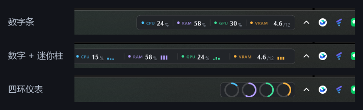
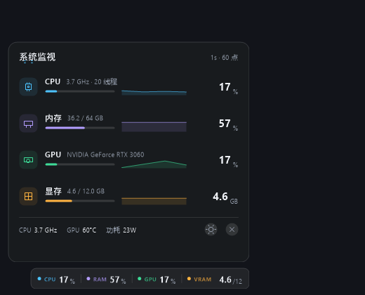
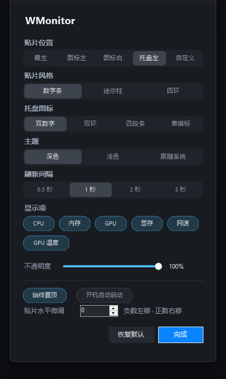
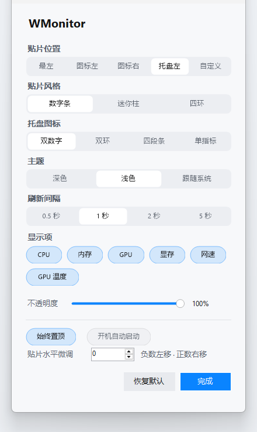

<div align="center">

# WMonitor

**Win11 任务栏系统监视器** — CPU / 内存 / GPU / 显存 / 网速 / 温度，一行读完。

[](https://github.com/kermmr/WMonitor)
[](https://dotnet.microsoft.com/)
[](LICENSE)
[](https://github.com/kermmr/WMonitor/releases)


</div>

---

## 为什么又做一个

任务管理器要开窗口才能看；多数托盘工具不支持 GPU 显存，或者自己就吃掉几十 MB 和几个点的 CPU。

WMonitor 是吸附在**任务栏托盘图标左侧**的一行贴片，点一下展开 60 秒曲线。常驻 **41 MB 内存、0.3% CPU**（单核，1 秒刷新），不碰 Explorer、不抢焦点、不进 Alt-Tab。

## 功能

- **贴片三种形态** — 数字条 / 数字 + 迷你柱 / 四环仪表
- **五种位置** — 任务栏最左、应用图标左边、应用图标右边、托盘箭头左边、自定义（直接拖动，落在任务栏上自动吸附，落到桌面就悬浮）
- **托盘图标四种** — 双数字 / 双环 / 四段条 / 单指标
- **深色 / 浅色 / 跟随系统**，贴片不透明度 0–100% 可调（底色和描边一起淡出，文字保持清晰）
- **详情面板** — 四行指标 + 60 点曲线 + 温度 / 功耗 / 频率
- **显示项可关** — CPU、内存、GPU、显存、网速、GPU 温度
- 单实例、开机自启、崩溃日志、`--probe` 诊断模式

## 截图

### 三种贴片形态



### 详情面板



### 设置窗口

<p>
  
  
</p>

### 浅色主题


## 安装

到 [Releases](https://github.com/kermmr/WMonitor/releases) 下载，二选一：

| 文件 | 大小 | 说明 |
|---|---|---|
| `WMonitor-v0.03-framework.exe` | 288 KB | 需要 [.NET 8 桌面运行时](https://dotnet.microsoft.com/download/dotnet/8.0)（Win11 多半已装） |
| `WMonitor-v0.03-portable.exe` | 63 MB | 自包含，双击即用，适合拷给别人 |

双击运行，贴片自动出现在任务栏托盘左侧，托盘区出现图标。没有安装程序，删掉 exe 就卸载干净（配置在 `%APPDATA%\WMonitor\`）。

## 使用

| 操作 | 效果 |
|---|---|
| 点贴片 | 展开详情面板（点面板外自动收起） |
| 拖贴片 | 自由定位；落在任务栏上自动垂直居中，落到桌面就悬浮 |
| 点面板齿轮 / 双击托盘图标 | 打开设置 |
| 右键托盘图标 | 快速切换位置、风格、主题、显示项，暂停或退出 |

## 数据来源

| 指标 | 来源 |
|---|---|
| CPU 占用 | PDH `\Processor Information(_Total)\% Processor Utility`（任务管理器同款口径） |
| CPU 频率 | PDH `% Processor Performance` × 注册表基频 |
| 内存 | `GlobalMemoryStatusEx` |
| GPU 利用率 | NVML（N 卡）；无 N 卡时回落 PDH `\GPU Engine(*)` 按 LUID 聚合 |
| 显存占用 | PDH `\GPU Adapter Memory(*)\Dedicated Usage`（含系统占用，与任务管理器一致） |
| 显存总量 | NVML，回落注册表 `qwMemorySize` |
| 温度 / 功耗 | NVML（没有 N 卡时不显示，而不是显示 0） |
| 网速 | `NetworkInterface.GetIPStatistics` 差分，网卡列表缓存 30 秒 |

> 不用 `Win32_VideoController.AdapterRAM` 取显存容量 —— 那是 32 位字段，12 GB 的卡会报成 4 GB。

## 从源码构建

需要 .NET 8 SDK。

```bash
git clone https://github.com/kermmr/WMonitor.git
cd WMonitor
dotnet build -c Release

# 单文件（框架依赖）
dotnet publish -c Release -r win-x64 --self-contained false \
  -p:PublishSingleFile=true -o build/framework

# 单文件（自包含）
dotnet publish -c Release -r win-x64 --self-contained true \
  -p:PublishSingleFile=true -p:IncludeNativeLibrariesForSelfExtract=true \
  -p:EnableCompressionInSingleFile=true -o build/portable
```

## 已知限制

- Win11 已移除 Deskband，任何软件都无法真正把控件嵌进任务栏。这里用的是**分层窗口贴片**：无边框、置顶、不抢焦点，吸附在托盘左侧，视觉上与任务栏一体；任务栏换位置、改高度、自动隐藏、Explorer 重启后会自动重贴。
- 只贴主屏任务栏（`Shell_SecondaryTrayWnd` 未支持）。
- "应用图标右边"这个锚点没有可靠的 HWND 可用（`MSTaskListWClass` 只覆盖 440px，Win11 任务栏的 UIA 树是空的），用任务栏中心到托盘左边的中点估算，误差约 30px，可用设置里的水平微调修正。
- 无 N 卡（纯 AMD / Intel）时 GPU 利用率改走 PDH，采样开销从 0.3 ms 升到约 2 ms。

## 文档

架构、数据源、UI 规格、构建发布、踩坑记录都在 [`docs/`](docs/)；接手开发先读 [`AGENTS.md`](AGENTS.md)。

## 许可

[MIT](LICENSE)
